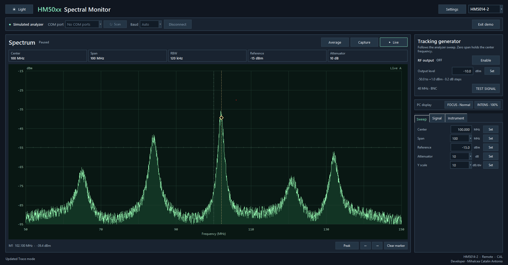
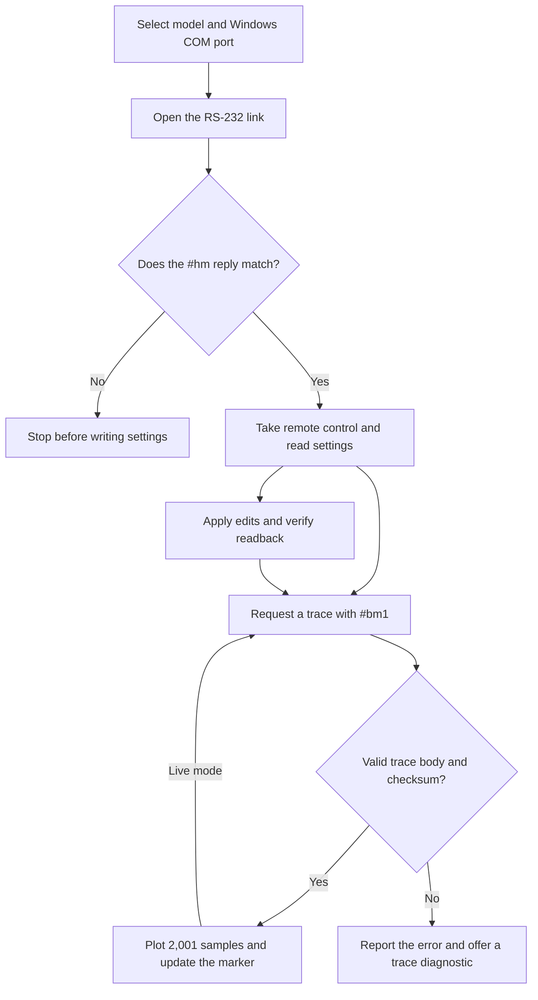

<p align="center">
  
  
  
  
  
  
</p>

<p align="center">
  
</p>

<h1 align="center">HM50xx Spectral Monitor</h1>

<p align="center">
  A Windows app for the HAMEG HM5014-2 and HM5530 spectrum analyzers. Connect over USB-to-RS-232 to view the spectrum live, adjust instrument settings, and control the tracking generator or test source.
</p>

<!-- When the recording is ready, replace this centered image block with the video URL GitHub inserts when you drop an MP4 into its Markdown editor. Put that URL on a line by itself. -->
<p align="center">
  
</p>

<p align="center">Final version <strong>1.3.2</strong> · 23/11/2026</p>

## Getting started

Run `HM50xx-Spectral-Monitor-Setup.exe` on Windows 10 or 11 x64. The per-user installer includes Python and Tk. If Windows does not list the serial adapter in Device Manager, install the adapter's driver. Select **Demo** to explore the app with simulated data.

To run from source, use Python with Tk support and run these commands from the project root.

```powershell
python -m pip install -r requirements.txt
python main.py
```

### Connect an analyzer

1. Use a true **USB-to-RS-232** adapter and a shielded, straight-through DB9 connection under 3 m. The HM5530 manual specifies double shielding. If an optional **HO720** is fitted, hold **DISPLAY MODE** to check its selected interface and select RS-232 if needed.
2. Power on the analyzer. Select the correct model and COM port in the app. Use **Scan** if the port list needs refreshing.
3. Start with **Auto** baud and select **Connect**. The app verifies the instrument identity before requesting remote control and reading settings.
4. Select **Live** for recurring updates or **Capture** for one sweep. **Pause** keeps the last trace on screen.

| Serial link | HM5014-2 | HM5530 |
| --- | --- | --- |
| Power-on baud rate | 4,800 | 9,600 |
| Supported baud rates | 4,800 / 9,600 / 38,400 / 115,200 | 4,800 / 9,600 / 19,200 / 38,400 / 115,200 |
| Serial framing | 8 data bits, no parity, 1 stop bit | 8 data bits, no parity, 1 stop bit |
| Flow control | None | None |

**Auto** keeps the detected baud rate by default. The optional fast link setting attempts 115,200 baud and verifies the link again. A trace block alone takes about 4.27 s at 4,800 baud or 0.18 s at 115,200 baud, plus instrument and adapter latency.

The analyzer's female DB9 uses pin 2 for transmit, pin 3 for receive, and pin 5 for signal ground. Pin 9 carries +5 V for supported accessories. Leave it disconnected in custom adapter wiring.

## How it works



The app sends ASCII commands prefixed with `#` and terminated by a carriage return. The documented `#bm1` reply is a 2,048-byte block with 2,001 samples, center-frequency metadata, a three-byte checksum, and a final carriage return. The HM5014-2 reader can recover a complete trace body when the delimiter varies and both the checksum and center-frequency field validate.

The display uses a ten-by-eight graticule. With verified settings, it maps sample positions to frequency and amplitude. Zero span shows sweep position as a percentage. Memory B and A−B use graticule-relative axes when absolute trace metadata is unavailable.

- Click the graph to place a software marker. Select **Peak** to move it to the highest sample, then use **←** and **→** to move by one sample.
- Select **Average** to display averaging performed by the analyzer. Select it again to return to trace A. While paused, select **Capture** to see the new trace.
- Use **FOCUS** and **INTENS** under **PC display** for trace width and contrast. The instrument's CRT controls are on its front panel.

## Analyzer settings

The tables list the values exposed by the app. A dash indicates that the control is unavailable for that model. Readback reflects the instrument's accepted value, which can depend on other settings.

### Sweep and amplitude

| Control | Command | HM5014-2 | HM5530 |
| --- | --- | --- | --- |
| Center frequency | `#cf` | 0–1,050 MHz | 0–3,000 MHz |
| Span | `#sp` | Zero span or 1, 2, 5, 10, 20, 50, 100, 200, 500, 1,000 MHz | Zero span or 1–3,000 MHz |
| Start frequency | `#sr` | — | 0–3,000 MHz |
| Stop frequency | `#st` | — | 0–3,000 MHz |
| Reference level | `#rl` | −99.6 to +10.0 dBm in 0.2 dB steps | −110.0 to +20.0 dBm in 0.1 dB steps |
| Auto reference | `#ra` | — | On / Off |
| Input attenuator | `#at` | 0–40 dB in 10 dB steps | 0–50 dB in 10 dB steps |
| Vertical scale | `#db` | 5 or 10 dB/div | 5 or 10 dB/div |
| Instrument amplitude unit | `#du` | dBm | dBm, dBmV or dBµV |

Numeric center, start, stop, and HM5530 span values accept 0.001 MHz steps. The app displays absolute levels in dBm and converts them to the HM5530's selected instrument unit when sending commands.

### Signal processing and markers

| Control | Command | HM5014-2 | HM5530 |
| --- | --- | --- | --- |
| Resolution bandwidth | `#bw` | 9, 120 or 1,000 kHz | 9, 120 or 1,000 kHz |
| Auto resolution bandwidth | `#ba` | — | On / Off |
| Video filter | `#vf` | On / Off | On / Off |
| Trace mode | `#vm` | Live A, Memory B, A−B, Average, Max Hold | Live A, Memory B, A−B, Average, Max Hold |
| Detection | `#dm` | On / Off | — |
| Hardware marker mode | `#mk` | — | Off, Marker, Delta Marker |
| Hardware marker frequency | `#mf` | — | 0–3,000 MHz |
| Delta marker frequency | `#df` | — | −3,000 to +3,000 MHz |
| Marker level | `#lv` | — | Read-only. Absolute level or delta, depending on the active marker mode. |
| Copy A to B | `#sa` | Store trace A in B | Store trace A in B |

### RF sources

| Control | Command | HM5014-2 | HM5530 |
| --- | --- | --- | --- |
| RF output | `#tg` | Tracking generator on / off | 50 MHz test source on / off |
| Output level | `#tl` | −50.0 to +1.0 dBm in 0.2 dB steps | −10.0 to 0.0 dBm in 0.2 dB steps |
| Separate BNC test output | `#cf` for tuning | **TEST SIGNAL** offers a 48 MHz center preset once the tracking generator reads as off. Use the physical TEST SIGNAL button to add the carrier. | — |

The HM5014-2 tracking generator follows the analyzer sweep from 0.15 to 1,050 MHz. At zero span it holds the center frequency. Its separate BNC carrier is nominally 48 MHz at about −30 dBm. The HM5530 source has a fixed 50 MHz fundamental with harmonics. Set and verify the output level before enabling RF.

### Instrument control and diagnostics

| Control or action | Command | HM5014-2 | HM5530 |
| --- | --- | --- | --- |
| Take or release control | `#kl` | Remote / Front panel | Remote / Front panel |
| Baud rate change | `#br` | See baud table | See baud table |
| Single-shot mode | `#es` | On / Off | On / Off |
| Trigger one sweep | `#ss1` | Starts a one-second sweep and returns the previous sweep after priming | Starts a one-second sweep. Use **Capture** to read it. |
| External trigger | `#et` | — | On / Off |
| Save and recall settings | `#sv`, `#rc` | Slots 0–9 | — |
| Capture trace | `#bm1` | Single capture or Live | Single capture or Live |
| Instrument model | `#hm` | Read-only | Read-only |
| Firmware version | `#vn` | Read-only | Read-only |
| Calibration status | `#uc` | Read-only, CAL / UNCAL | Read-only, CAL / UNCAL |

**Read settings** refreshes the controls from the analyzer. Single-shot mode, external trigger, baud changes, and save/recall are write-only operations in the app. The serial console accepts one supported command at a time. For example, `#tg` queries output state and `#tg0` requests output off. On the HM5530, use the selected instrument unit for raw level setters.

### App preferences

| Preference | Choices |
| --- | --- |
| Interface | English or Romanian, light or dark |
| Serial connection | Model, COM port, Auto or manual baud, optional fast Auto link |
| Live acquisition | Start after connection, request delay of 100 / 250 / 500 / 1,000 / 2,000 ms |
| PC display | FOCUS trace width, INTENS contrast |
| Software marker | Click, Peak, move left/right, or clear |

## Troubleshooting

| Symptom | First check |
| --- | --- |
| COM port missing | Check Device Manager, then select **Scan**. |
| Port busy | Close other serial utilities using the COM port. |
| Instrument replies are missing | Check model, baud, and straight-through wiring. On an HM5530 with HO720, check its selected interface. |
| Settings are visible but cannot be edited | Select **Instrument → Take control**. |
| Trace fails verification | Retry **Capture**. If the error repeats, select **Instrument → Save trace diagnostic** to record the firmware, baud rate, and rejected response. |
| Trace stops in triggered mode | Check single-shot and external trigger settings. |

## Project structure

```text
HM50XX-Monitor-App/
├── main.py                       Application entry point
├── hameg_studio/
│   ├── app.py                    Tkinter UI and acquisition workflow
│   ├── profiles.py               Instrument settings, limits, and command formats
│   ├── protocol.py               RS-232 transport, readback, and frame validation
│   ├── spectrum.py               Sample-to-frequency and amplitude conversion
│   ├── display.py                Chart and software marker
│   ├── demo.py                   Simulated analyzer
│   ├── preferences.py            Stored app settings
│   ├── i18n.py                   English and Romanian labels
│   └── theme.py                  Light and dark styles
├── doc/                          Reference files on GitHub and README artwork
│   └── readme/                   Application icon and video placeholder
├── packaging/                    Installer script, icon, and source packaging
├── tests/                        Protocol and desktop workflow tests
├── build.ps1                     Windows build entry point
├── requirements.txt              Runtime dependency
├── requirements-build.txt        Build dependency
├── LICENSE
└── README.md
```

### Build and test

Use Windows x64, Python with Tk, and Inno Setup 6.3 or later. Run `.\build.ps1` from the project root. The script builds the portable app with PyInstaller and creates the installer and matching source ZIP in `dist/`. Use `-SkipInstaller` for a portable-only build.

```powershell
python -m unittest discover -s tests -v
python main.py --smoke-test
```

The tests cover serial connection, instrument readback, RF controls, trace handling, and the desktop workflow using simulated ports.

## Version history

| Version | Main change |
| --- | --- |
| 1.0.0 | Initial Windows build with serial control, spectrum capture, and a simulator for both models. |
| 1.1.0 | Renamed the app to HM50xx Spectral Monitor. Improved connection defaults, readback recovery, and single-shot timing. |
| 1.1.1 | Improved HM5014-2 trace framing and added export of failed trace replies for diagnostics. |
| 1.2.0 | Added a dedicated Average button for the analyzer's averaging mode. |
| 1.3.0 | Added TEST SIGNAL controls and local FOCUS and INTENS adjustments. |
| 1.3.1 | Added left and right buttons for moving the software marker one sample at a time. |
| **1.3.2 · Final** | Added developer attribution, the project link, the release date, GNU GPL v3 licensing, and a matching source archive. |

## License

Copyright (C) 2026 Mihalcea Catalin Antonio. HM50xx Spectral Monitor is licensed under the [GNU General Public License version 3](LICENSE) (`GPL-3.0-only`). The installer contains the license text, the matching application source archive, and separate notices for bundled dependencies. The license is also available under **Settings → GNU GPL v3**.

## Manufacturer specifications

The application follows the manufacturer datasheets and operating manuals for the implemented instrument controls, parameter readbacks, RF sources, and spectrum transfers.

- [HAMEG HM5014-2 datasheet](https://www.appliedin.com/www/assets/products/HM_5014-2/HM5014-2_DataSheet.pdf) · [Operating manual](https://www.appliedin.com/www/assets/products/HM_5014-2/HM5014-2_OperationsManual.pdf)
- [HAMEG HM5530 operating manual and specifications](https://www.instruments.albedo.biz/download/hameg/doc/HM5530_MO.pdf)

## Credits

- **Mihalcea Catalin Antonio** — Developer. [HM50XX-Monitor-App on GitHub](https://github.com/ANTzacalie/HM50XX-Monitor-App)
- **Mitrache Cristian Mario** — Contributed to the UI, reviewed the manufacturer datasheets, and performed tests on physical instruments.
